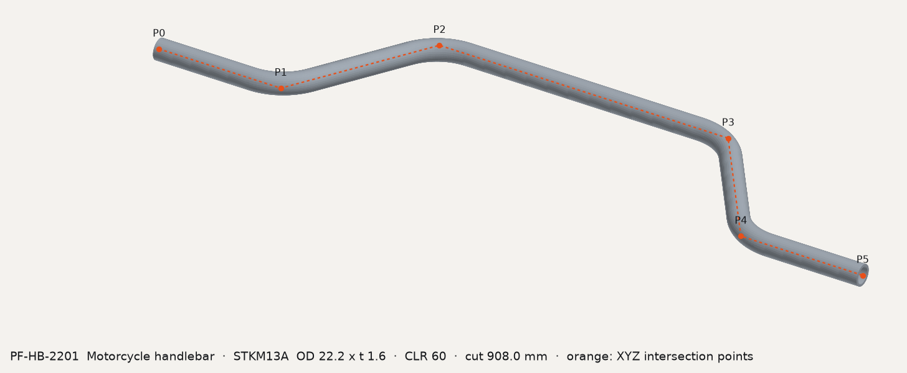
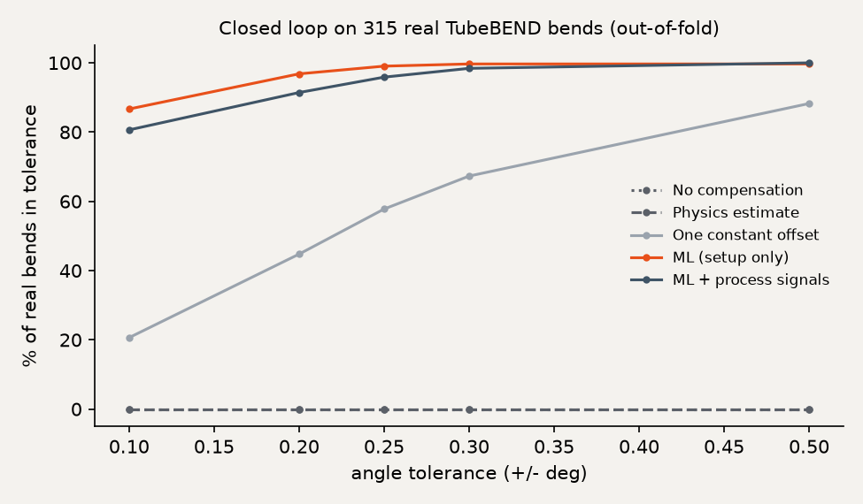
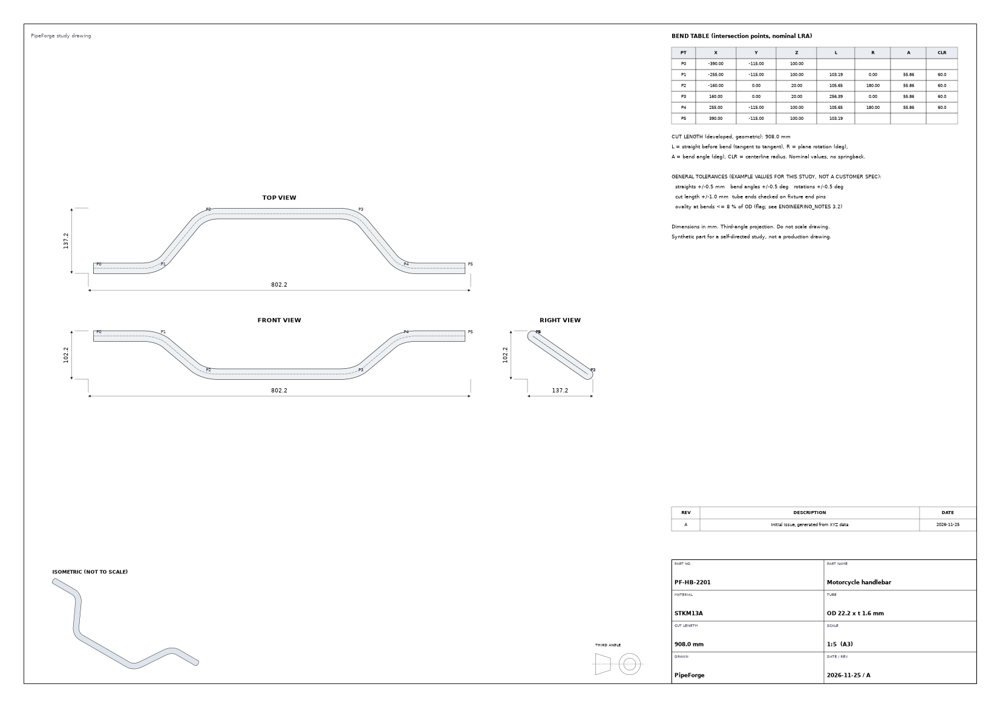
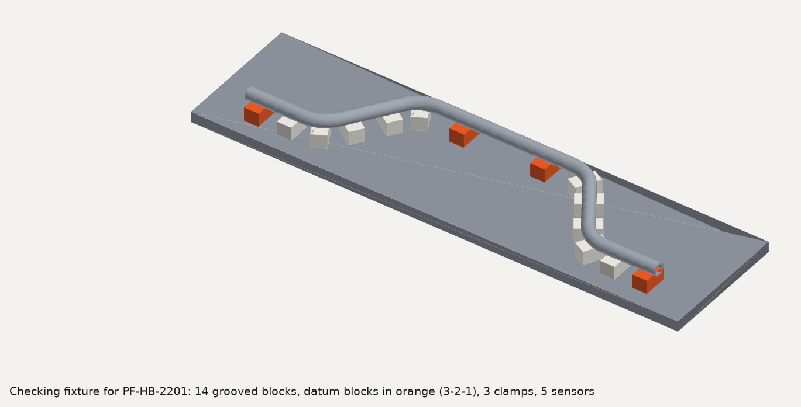
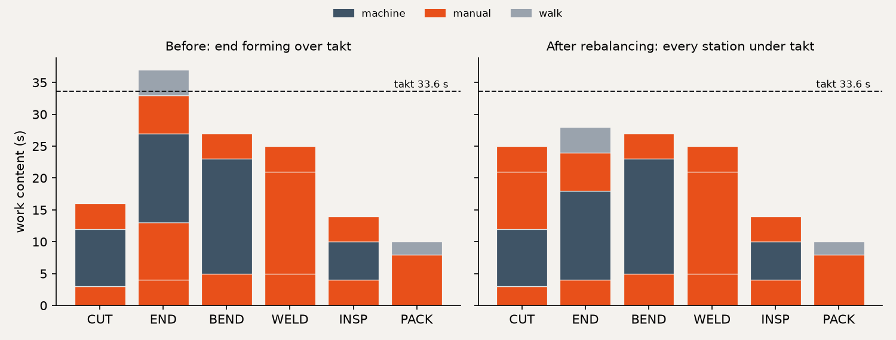
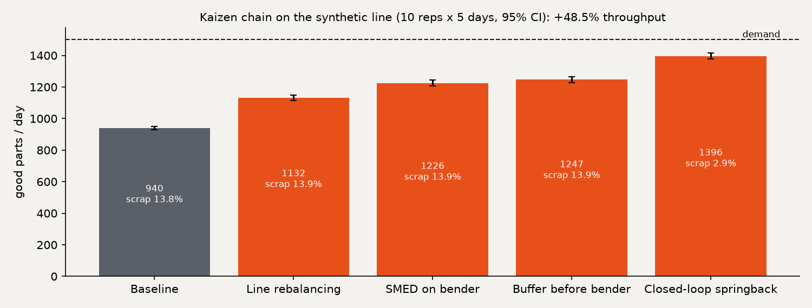

# PipeForge: AI-assisted pipe bending and production engineering

[](https://github.com/Mr-Bathwal/pipeforge/actions/workflows/ci.yml)

**Live app:** https://pipeforge.streamlit.app · **Live showcase:** https://pipeforge-site.vercel.app · **Code:** this repository

PipeForge takes a bent-tube part (XYZ centerline points, OD, wall, CLR, JIS material) and produces what a process engineer needs to make and check it:

- **CAD and drawing:** parametric 3D CAD (CadQuery, STEP) and an A3 engineering drawing with a bend table.
- **Bending program:** a springback-compensated **XYZ-to-LRA/YBC** program.
- **Manufacturability checks** taken from published bending guides.
- **Springback ML:** a model trained on **TubeBEND, 318 real rotary-draw bends**.
- **Fixture and station:** a checking fixture with grooved blocks and 3-2-1 datums, plus a PLC-style automated inspection station.
- **Line simulation:** a SimPy model of the production line with takt, OEE, Yamazumi and kaizen scenarios.
- **Process sheet:** a bilingual 工程表 (control plan).

It was built for a technical-position application to Yamato Industrial (やまと興業, Hamamatsu). Yamato bends pipes and makes control cables for two- and four-wheelers, so the sample parts are a handlebar, a frame tube, and brake, fuel, coolant and lubrication pipes.

> **Read this first: what is real and what is not**
> - This is a **self-directed engineering study**. Nothing here was deployed in a factory, validated on a production line or used by a customer.
> - **Synthetic:** all six sample parts, and every line-simulation parameter (cycle times, failures, yields).
> - **Real:** the springback data (TubeBEND, CC BY 4.0, credited below) and every JIS material value, each cited with its URL.
> - **Engineering estimates**, with the formula, assumptions and source in [docs/ENGINEERING_NOTES.md](docs/ENGINEERING_NOTES.md): physics springback, wall thinning and ovality.
> - **Regenerated by scripts:** every number in this README comes from committed artifacts (see [Reproduce](#reproduce)).



## Results

### Springback model on real data (TubeBEND)

315 valid bends (3 failed runs dropped) of a 22 × 1 mm stainless tube at CLR 33 mm, on a WAFIOS RBV 35.

**Label.** Springback is measured with a "virtual CMM": a circle is fitted to every 2 mm scan slice of both legs, and an axis through the circle centres. Replicate scatter is 0.07°. The label agrees with the dataset's arc angle at r = 0.99. Measured springback is **2.60° ± 0.28°**.

**Evaluation.** GroupKFold by machine setup, 5 folds × 5 repeats: every score is for a setting the model never saw.

| Model, features | MAE | R² |
|---|---|---|
| Constant (mean) | 0.245° | −0.22 |
| Ridge, setup | 0.165° | 0.49 |
| **XGBoost, setup parameters only** | **0.050° ± 0.016°** | **0.91 ± 0.08** |
| Ridge, setup + 52 force/torque features | 0.048° ± 0.029° | 0.89 |
| Physics estimate (elastic–plastic, SUS304 minimums) | 2.245° | − |

The textbook formula predicts 0.35° against 2.60° measured. Even at the full tensile strength it gives only 0.51°: pure-bending theory leaves out the machine and tooling effects. That gap is why shops do trial bends, and why learning from process data helps. Details, SHAP and limits are in the [model card](docs/MODEL_CARD.md).



**Closed loop on the real runs** (out-of-fold): **88.3% → 99.7%** of bends within ±0.5°. The comparison is one constant springback offset for every setup against setup-aware ML compensation. In fairness, the ML model learns what trial bends at each changeover would find. Its value is the first part right after a changeover, without the trial bends.

### Bending program, manufacturability and drawing



- **XYZ ↔ LRA:** exact round trips (1e-13 mm against a 0.01 mm requirement), and 150 random programs pass a Hypothesis property test.
- **Compensated YBC:** overbend C = A + springback. The feed Y is also shortened by the tangent growth that springback causes (the radius grows at constant arc length), so the made part's intersection points land on nominal. Tested to 1e-6 mm.
- **DFM rules:**
  - D of bend (Pines);
  - mandrel and wiper from the **Bend Tooling selection chart**, with its material and angle shifts;
  - clamp length (Bend Tooling) and distance between bends (Pines);
  - first straight and collet depth (McGrew);
  - a **machine-frame collision simulation** of the bend sequence, tried from both ends;
  - self-interference;
  - **required elongation against the JIS standard.**
- **What the checks found:**
  - Every steel and stainless sample warns that JIS G 3445 and G 3459 do not guarantee elongation at OD ≤ 40 mm, so it must go into the purchase specification.
  - The A6063-T5 coolant pipe **fails**: it needs 20% elongation against an 8% minimum. The fix is to bend it in O or T4 temper, or raise the CLR.

### Jig and fixture, automated inspection station



**Fixture.** The part is laid flat by principal axes. Grooved blocks sit at 20% and 80% of each straight and at every arc midpoint. **Each groove is cut by a rod swept along the true centerline**, so it follows arcs and slopes exactly. Datums follow 3-2-1. A CAD test proves the go/no-go behaviour: the nominal tube seats, and a tube 0.6 mm off hits the blocks. Each block exports as an STL for a **3D-printable prototype**.

**Station.** A PLC-style scan-cycle state machine with barcode, clamp, seat, end-position and NG-bin interlocks (poka-yoke). In a Hypothesis test, 300 random input streams never produce a PASS label with a sensor off.

### Production line and kaizen (synthetic line)




The line is cut, end form, CNC bend, TIG weld bracket, checking fixture, pack. Takt is 33.6 s. Results are from 10 replications × 5 days per scenario, with common random numbers:

| Scenario | Good parts/day | Scrap |
|---|---|---|
| Baseline | 940 ± 10 | 13.8% |
| + line rebalancing | 1,132 ± 16 | 13.9% |
| + SMED on the bender (25 to 10 min) | 1,226 ± 18 | 13.9% |
| + buffer sizing | 1,247 ± 18 | 13.9% |
| + closed-loop springback (yield from the real TubeBEND runs) | **1,396 ± 19** | **2.9%** |

That is **+48.5% throughput and −10.9 points of scrap** on the synthetic line. The [A3 report](docs/KAIZEN_A3.md) has the root cause, countermeasures and yokoten. The [line transfer playbook](docs/LINE_TRANSFER_PLAYBOOK.md) covers setting the cell up in a new plant.

### Process sheet (工程表)

An Excel and PDF control plan with EN/JP headers (工程, 設備, 管理項目, 検査方法, 頻度, 異常処置). It is filled from the computed program, DFM, fixture and station; welding parameters point to the WPS instead of being invented. A **study PFMEA** sheet links each failure mode to the controls PipeForge generates. The bend-angle line cites the real result: 11.7% of bends out of tolerance with one offset, 0.3% with ML. The S, O and D ratings are the author's judgement.

The optional LLM summary (any OpenAI-compatible key; off by default) is **rejected if it contains any number not in the computed data**.

## How the listing maps to the repository

| Yamato listing line | Where | Evidence |
|---|---|---|
| CAD Design | `cad.py`, `mesh.py` | STEP/STL for 6 parts; solid volume = annulus × developed length to 1e-15 |
| Engineering Drawing Reading | `drawing.py` | A3 third-angle drawings with bend table, title block, revisions |
| Manufacturing / Production Engineering | `compensation.py`, `dfm.py`, `process_sheet.py` | XYZ-to-LRA/YBC programs, sourced DFM rules, 工程表, study PFMEA |
| Mechanical Engineering Fundamentals | `mechanics.py`, [ENGINEERING_NOTES](docs/ENGINEERING_NOTES.md) | Elastic–plastic springback, wall thinning, ovality, worked examples |
| Jig & Fixture Design | `fixture.py`, [FIXTURE_DESIGN](docs/FIXTURE_DESIGN.md) | Grooved-block fixture, 3-2-1 datums, go/no-go CAD test, printable blocks |
| Machine & Automation Design | `station.py` | PLC-style sequence, interlocks, I/O list |
| Production Line Setup | `line_sim.py` | Takt, OEE (A × P × Q), Yamazumi, bottleneck |
| Process / Continuous Improvement | `kaizen.py`, [KAIZEN_A3](docs/KAIZEN_A3.md) | Rebalancing, SMED, buffer, closed-loop springback |
| Problem Solving | commit history, docs | E.g. label method chosen by replicate scatter; DFM catches a temper problem; root-caused a CAD crash |
| Japan | [README_ja](README_ja.md), app | Bilingual UI labels and process sheet, JIS materials, TPS vocabulary |

## Repository

```
pipeforge/
  geometry.py      XYZ <-> LRA, tangent points, developed length
  cad.py           CadQuery sweep -> STEP/STL;  mesh.py: kernel-free mesh -> STL
  drawing.py       A3 third-angle drawing (PDF/SVG)
  materials.py     JIS STKM11A, STKM13A, SUS304TP, A6063-T5, every value with its URL
  mechanics.py     springback, wall thinning, ovality (engineering estimates)
  dfm.py           manufacturability rules + bend-sequence collision simulation
  compensation.py  nominal LRA -> compensated YBC (overbend + radius growth)
  springback_ml/   TubeBEND download, safe loader, virtual-CMM labels, training, SHAP
  fixture.py       checking fixture;  station.py: PLC-style sequence
  line_sim.py      SimPy cell;  kaizen.py: scenarios
  process_sheet.py 工程表 XLSX/PDF;  llm_assist.py: grounded summary
  pipeline.py      one call from a part to all of the above
app/streamlit_app.py   seven-panel bilingual app
site/                  scroll-driven 3D showcase (three.js, GSAP), reads site/data.json; on Vercel
artifacts/             generated STEP, STL, drawings, programs, sheets, fixtures, models, results
docs/                  engineering notes, model card, A3, fixture design, playbook, architecture
tests/                 141 tests (pytest, Hypothesis, Streamlit AppTest)
```

The architecture diagram is in [docs/ARCHITECTURE.md](docs/ARCHITECTURE.md).

## Reproduce

```bash
make setup        # uv venv (Python 3.12) + requirements-dev (CadQuery included)
make test         # 141 tests
make train        # download TubeBEND (797 MB, md5-checked), build features, train, evaluate
make sim          # line simulation + kaizen scenarios -> artifacts/line
make artifacts    # STEP/STL/drawings/programs/sheets/fixtures for the sample parts
make figures      # the figures in this README
make app          # streamlit run app/streamlit_app.py
```

**Deployment.** The hosted app uses `requirements.txt`, which leaves out CadQuery, a heavy install:
- it serves the **pre-generated STEP files** in `artifacts/` for the sample parts;
- everything else (3D view, STL, drawing, program, DFM, fixture, line simulation, process sheet) is computed live, including for a pasted custom part.

Fixture CAD is not generated for the 4.76 mm brake line: the groove boolean runs away with memory in OpenCascade. Its fixture design table is still produced.

## Prior art, and what is different

The closest prior work is Yazdani et al. (Univ. Siegen), an explainable-ML web tool with 3D visualisation for rotary tube bending. It is trained on finite-element simulations.

PipeForge differs in three ways:
- it goes **end to end**, from CAD to bending program, fixture, station, line and control plan;
- its springback model is trained and evaluated on **real** bends (TubeBEND), grouped by machine setup;
- it is honest about where physics falls short.

Related ML work:
- Somchai et al. 2023, ANN for CNC tube-bending springback, FME Transactions, doi 10.5937/fme2303405K;
- Sun et al. 2022, a digital-twin-enhanced model, arXiv 2207.00961;
- Sun et al. 2022, a physics-logic-enhanced network, arXiv 2209.09870.

Against commercial tube CAD (for example SOLIDWORKS TubeWorks: CLR, LRA/XYZ, drawings, springback and stretch compensation), PipeForge covers the same core and adds fixture, station and line design. It is a study, not a product.

**Not built** (cut for time per the plan): the control-cable routing calculator (M5) and vision inspection (M8). Neither is claimed anywhere.

## Credits and licences

- **TubeBEND dataset:** Z. Oz, J. Knoche, A. Yazdani, B. Engel, K. Van Laerhoven, *TubeBEND: A Real-World Dataset for Geometry Prediction in Rotary Draw Bending*, arXiv:2509.10272 (2025). Data on Zenodo, [10.5281/zenodo.18458823](https://zenodo.org/records/18458823), **CC BY 4.0**. Derived files and attribution are in [data/tubebend/ATTRIBUTION.md](data/tubebend/ATTRIBUTION.md). The raw data is not redistributed.
- **Engineering sources:** Bend Tooling Inc. (mandrel and wiper selection chart, formulas); Pines / The Fabricator; Tube Form Solutions; L. McGrew; Lee & Van Tyne; Wagoner et al. (ASM Handbook); Clark Fixture Technologies; ifm / GeTech; Carr Lane; oee.com; Lean Enterprise Institute; and the JIS G 3445, G 3459 and H 4080 tables. Each is cited where it is used.
- **Code:** MIT licence.

## 日本語の概要

PipeForge は、曲げパイプ部品の XYZ 点列・外径・肉厚・曲げ半径・JIS 材質から、次のものを一貫して作成する自主的なエンジニアリング検討です。
- 3D CAD（STEP）と図面（曲げ表付き）
- スプリングバック補正済みの曲げプログラム（XYZ→LRA/YBC）
- 製造性チェック
- 実データ（TubeBEND、実曲げ 318 本）によるスプリングバック予測モデル
- 検査治具と自動検査ステーション
- ライン シミュレーション（タクト・OEE・山積み表・改善）
- 工程表

ライン条件とサンプル部品は合成データであり、工場での導入実績はありません。詳しくは [README_ja.md](README_ja.md) をご覧ください。（日本語は学習中に作成したものです。）
