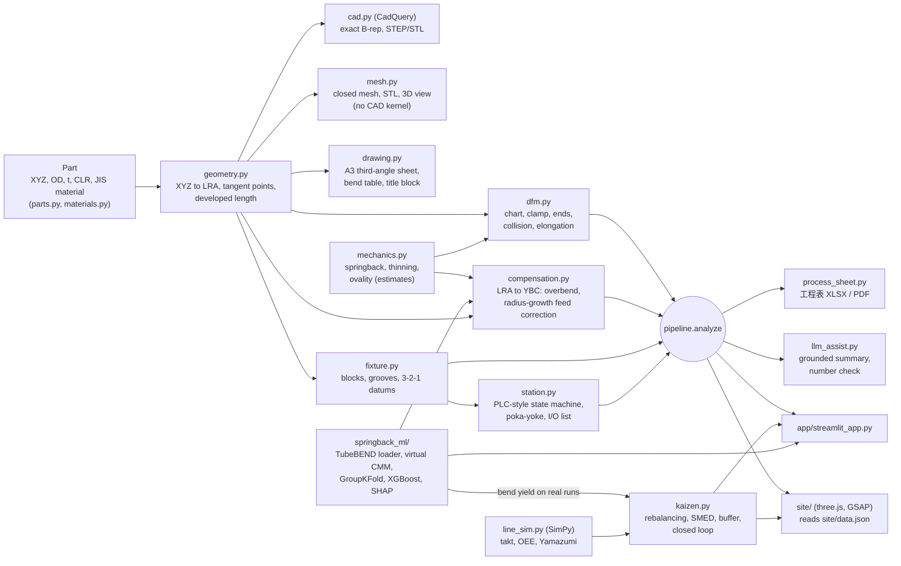

# Architecture

One part definition (XYZ points, OD, wall, CLR, material) flows through every module. `pipeline.analyze()` is the single entry point that the app, the artifacts script, the process sheet and the LLM assistant share. No module hard-codes a result: the README, the app and the site all read files that scripts regenerate.

## Data and regeneration

| Output | Made by | Consumed by |
|---|---|---|
| `data/tubebend/derived/runs.csv` | `python -m pipeforge.springback_ml.features` (needs the 797 MB download) | `train`, CI |
| `artifacts/springback/*` (metrics, models as XGBoost JSON, plots) | `python -m pipeforge.springback_ml.train` | app, kaizen, README |
| `artifacts/line/kaizen_results.*` | `python -m pipeforge.kaizen` | app, A3, README |
| `artifacts/parts/<part>/*` (STEP, STL, drawing, YBC, 工程表, DFM, fixture) | `python scripts/build_artifacts.py` (needs CadQuery) | app downloads on the host |
| `docs/figures/*.png` | `python scripts/build_figures.py` | README |
| `site/data.json` | `python scripts/build_site_data.py` | showcase site |

## Design decisions

1. **Two geometry back-ends.**
   - CadQuery gives exact solids for STEP; its volume equals annulus area × developed length to 1e-15.
   - `mesh.py` sweeps rings with parallel-transport frames, so the hosted app draws and exports STL for any typed-in part without a CAD kernel.
2. **LRA keeps a placement**, so XYZ round trips are exact. A bare LRA (what a bender holds) is compared by rigid alignment.
3. **Grooves are cut by a swept rod.** They follow arcs and slopes exactly; a CAD test shows the go/no-go behaviour.
4. **Safe data loading.** A restricted unpickler loads TubeBEND, and models are saved as JSON, so no pickle runs in the app.
5. **Honest evaluation.** GroupKFold by machine setup, fixed hyperparameters, a physics baseline, and random KFold shown only as the optimistic contrast.
6. **ML gated to its domain.** Outside the TubeBEND tube the pipeline falls back to physics or a measured value and says so.
7. **The LLM cannot add numbers.** Its text is rejected if any number is not in the computed JSON, and a deterministic template is always available.
8. **One transition table** drives the station logic, the Mermaid diagram, the app's graph and the tests.
9. **Common random numbers** across kaizen scenarios, so differences come from the change, not the noise.
