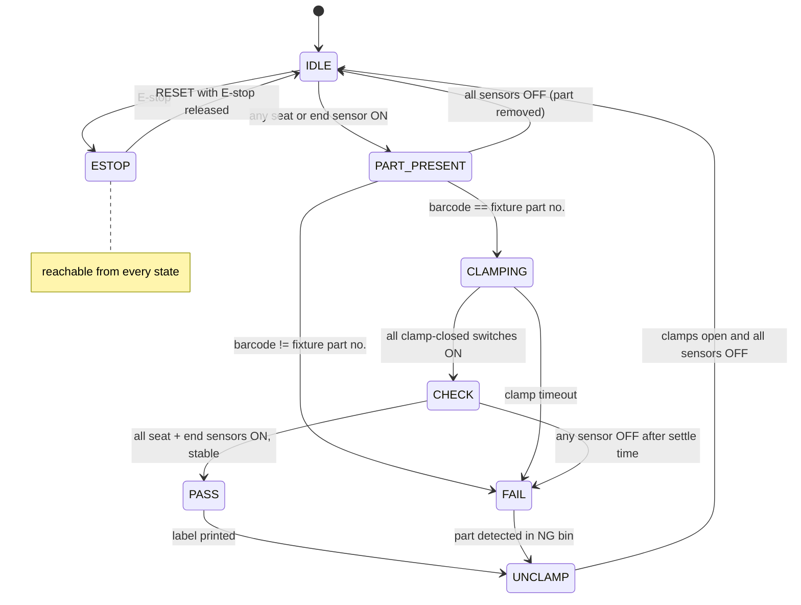

# Checking fixture and automated station: design notes

The fixture is generated by `pipeforge/fixture.py` and the station logic by `pipeforge/station.py`. Example output for the handlebar is in `artifacts/parts/PF-HB-2201/fixture/`:
- the assembly as STEP;
- plate and blocks as one STL;
- one STL per block for 3D printing.

## 1. What the fixture checks

A bent tube is accepted if it drops into every groove at once and both ends reach their stops. This is the classic hard gauge for bent tube (Clark Fixture Technologies, "Tube Fixture Design and Tolerance").

Clark's envelope rule: envelope = MMC + 2 × tolerance. A 12 mm tube at ±2 mm needs a 16 mm envelope. A tube whose centerline is off by more than about the groove clearance cannot seat in every block, so the fixture is a go/no-go gauge.

**The CAD proves this.** `tests/test_fixture.py::test_go_no_go_nominal_tube_seats_shifted_tube_does_not` builds the real solids:
- the nominal tube clears every groove;
- the same tube shifted 0.6 mm sideways (twice the 0.3 mm clearance) hits at least two blocks.

## 2. Frame and datums (3-2-1)

- **Laying the part flat.** The plate normal is the direction of least spread of the centerline (principal axes). Blocks therefore stay short and the part is stable. The lowest point of the tube sits 25 mm above the plate.
- **Datum A (3 points), vertical.** The three blocks that span the largest triangle in plan view.
- **Datum B (2 points), lateral.** The two blocks on the longest straight.
- **Datum C (1 point), axial.** The end stop at the tube start.

This is the 3-2-1 locating principle: three points fix a plane, two a line in it, one a position ([Carr Lane](https://www.carrlane.com/engineering-resources/fixture-design-principles/locating-clamping-principles)).

## 3. Block placement logic

- **Straights.** Each straight longer than three block lengths gets two blocks, at 20% and 80% of its length; a shorter straight gets one block at its middle.
- **Arcs.** Each arc gets one block at its midpoint.
- **Block shape.**
  - length 1.2 × OD (at least 20 mm);
  - width OD + 24 mm;
  - height from the plate to the tube centerline at that point.
- **Groove.** Cut by subtracting a rod of diameter OD + 2 × clearance (0.3 mm) swept along the **true centerline**. The groove therefore follows arcs and slopes exactly. A straight groove at an arc block would bind: over a 20 mm block on a 60 mm radius the sagitta is 0.8 mm, more than the clearance.
- **Rejections**, each one logged in the design:
  - a steep tube (|tangent·Z| > 0.70, about 44°) would not rest on a block; the fuel line's first straight, at 81°, is rejected this way;
  - another part of the tube passing through the block's footprint.

Clark gives no explicit support-spacing rule, so the 20%/80% placement is this study's choice. Its basis is that it supports each straight near both ends, so the straight's angle is checked.

## 4. Materials and prototype

| Use | Material |
|---|---|
| Production blocks | MC nylon (cast nylon) or aluminium A5052: kind to the tube surface, easy to machine |
| Plate | Aluminium or steel |
| Mounting holes | Ø11 for M10 |
| Prototype blocks | 3D-printed (PETG) from the per-block STLs, bolted to an aluminium or MDF plate |

**Maintenance:**
- check groove wear with a master part at a fixed interval;
- re-cut or replace worn blocks;
- keep the master part with the fixture.

## 5. Automated station (M4b)

Fitted to the fixture:
- **Clamps:** toggle clamps on the three datum-A blocks.
- **Sensors:**
  - an inductive proximity sensor under each clamped groove (PX1…PX3);
  - an end-position sensor at each tube end (END1, END2);
  - a reed switch per clamp cylinder.
- **Interfaces:** a barcode reader, a label printer, a stack light (andon) and an NG bin with its own sensor.

**Model.** This follows the GeTech sensor-based check gauges ([ifm application report](https://www.ifm.com/us/en/shared/successstories/reports/getech)): inductive sensors in the clamps confirm the part is seated, and a release is given only when every check passes.

### Sequence (generated from `station.TRANSITIONS`)

### Poka-yoke interlocks (each one has a test)

| Interlock | Why |
|---|---|
| PASS is reachable only from CHECK. The label output is energised only in PASS **and** only while every seat, end and clamp input is ON (re-checked in the output logic). | A good label cannot be printed for a bad part. Hypothesis feeds 300 random input streams, and none prints a label with a sensor off. |
| Clamps close only after the barcode matches the fixture's part number. | A wrong part is never clamped, so it cannot be "checked" on the wrong gauge. |
| After FAIL, the station waits for the NG-bin sensor. | A rejected part cannot drift back into the good flow. Removing it by hand is not enough. |
| Sensors must be stable for 3 scans before CHECK decides. | Flicker does not pass a part. |
| E-stop from any state drops every output. RESET works only with the E-stop released. | Safe stop. |

The I/O list (`station.io_list`) uses illustrative Siemens-style addresses (I0.0…, Q0.0…). It is a design sketch, not a wired panel.

## 6. Known limit

Fixture CAD is skipped for the 4.76 mm brake line. The OpenCascade boolean that cuts its swept groove runs away with memory. The fixture design (block table, datums, sensors) is still generated, and the app shows it.
